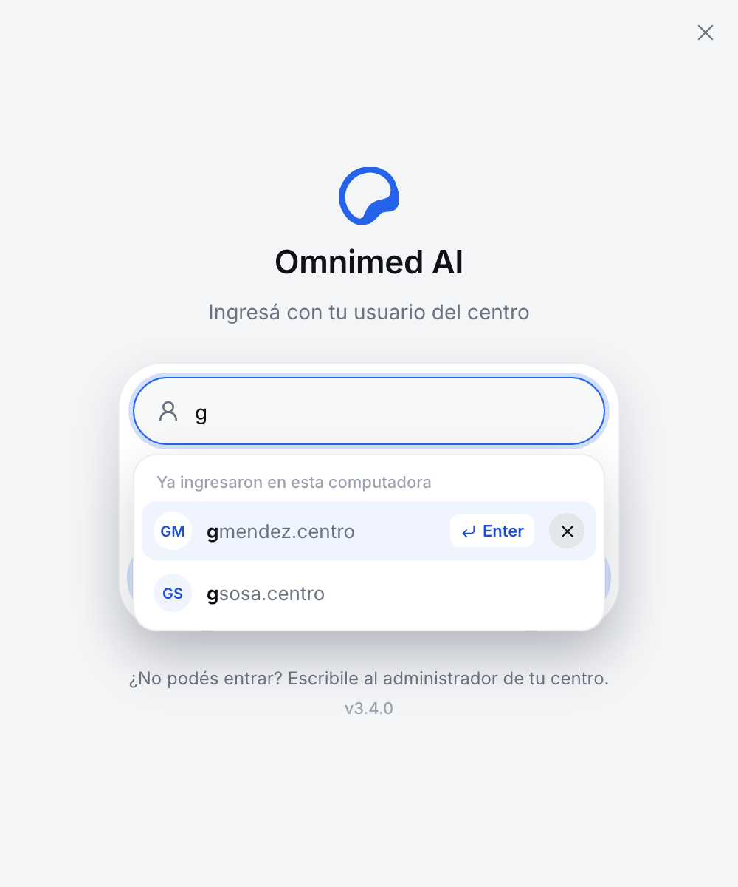
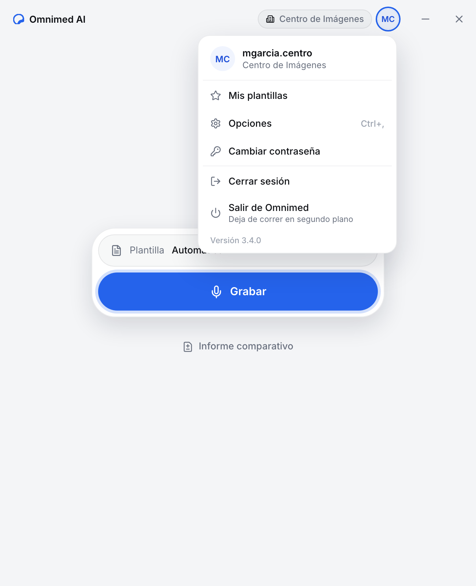
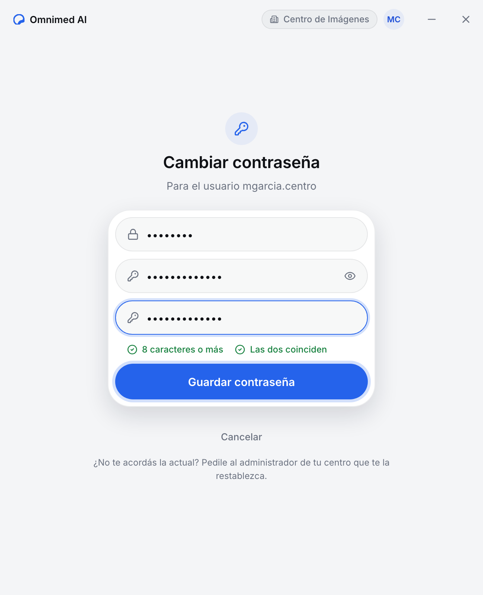

# Omnimed v3.4.0 · Entrar más rápido y cambiar tu contraseña

Dos cosas nuevas que nos venían pidiendo: no tener que escribir el usuario completo cada vez, y poder cambiar la contraseña sin pedírsela a nadie.

## Qué vas a ver

### El ingreso te sugiere los usuarios que ya entraron en esa computadora
Al abrir Omnimed, hacé clic en el campo de usuario: aparece la lista de los usuarios que **ya ingresaron en esa computadora**. Elegí el tuyo con un clic, o empezá a escribir y apretá **Enter**. Después solo falta la contraseña.

- Se guarda **solo el nombre de usuario**. La contraseña nunca se guarda: hay que escribirla siempre.
- La lista es de cada computadora. En una computadora donde nunca entraste, tu usuario no aparece.
- Si un usuario ya no usa esa computadora, pasá el mouse por encima y tocá la **X** para sacarlo de la lista.

### Podés cambiar tu contraseña desde la aplicación
En el menú de tu cuenta (arriba a la derecha) hay una opción nueva: **Cambiar contraseña**.

Escribís tu contraseña actual y la nueva dos veces. La nueva tiene que tener **8 caracteres o más**.

- En la computadora donde la cambiaste seguís con la sesión abierta. En las demás, Omnimed te va a pedir la contraseña nueva.
- Si no te acordás la contraseña actual, pedile al administrador de tu centro que te la restablezca.

### Arreglos en Mis plantillas
- Una plantilla que el centro comparte con varios médicos ya no aparece como «Mi versión» de uno solo. Si uno de ellos elige volver a la original, deja de verla solo él: a los demás no se les borra.
- Si le cambiaste el nombre a tu versión de una plantilla, sigue reemplazando a la original del centro. Antes, en algunos casos aparecían las dos en la lista.

## Qué no cambia
- Dictar, generar, refinar y copiar el informe funcionan igual que en la 3.3.0.
- Lo que copiás al sistema del centro es el mismo texto de siempre (más tu firma, solo si la activás).
- La burbuja, el modo oscuro, los atajos de teclado, la firma y los Autotextos siguen igual.
- Tu usuario y tu contraseña actuales siguen siendo los mismos: nada cambia si no la cambiás vos.

## Cómo actualizar
La aplicación se actualiza sola al reiniciarla; cuando la versión nueva ya está descargada, en el menú de tu cuenta aparece **Reiniciar y actualizar**. Si preferís hacerlo a mano, descargá el instalador desde esta página: en Windows `Omni.AI.Setup.3.4.0.exe`, en Mac `Omnimed-AI-3.4.0-universal.dmg` (abrilo y **arrastrá Omnimed AI a la carpeta Aplicaciones**; si te pregunta, elegí Reemplazar).
