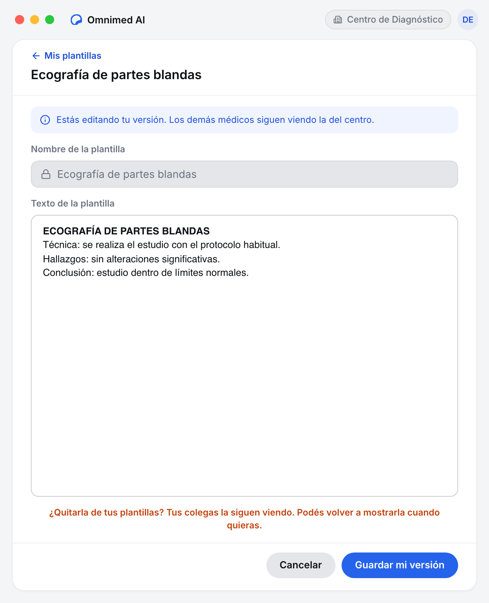
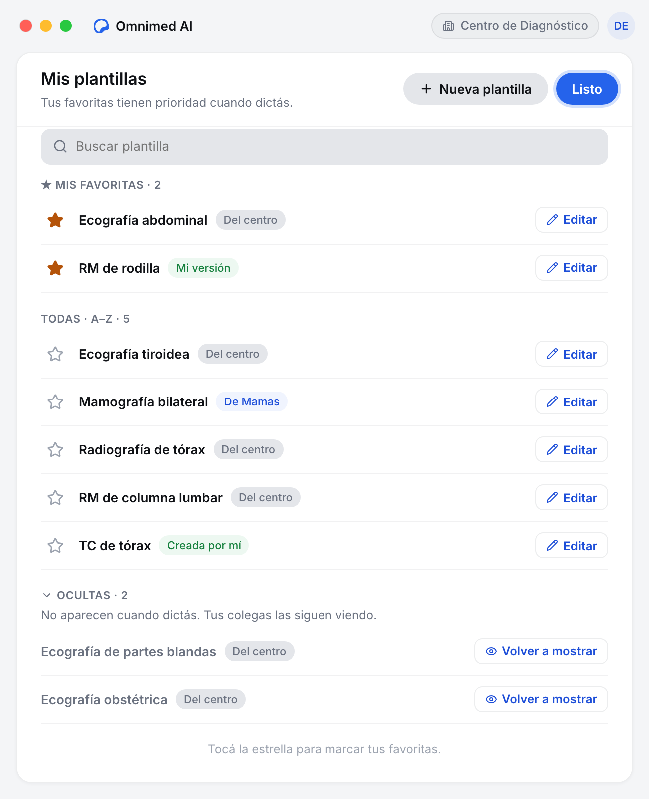
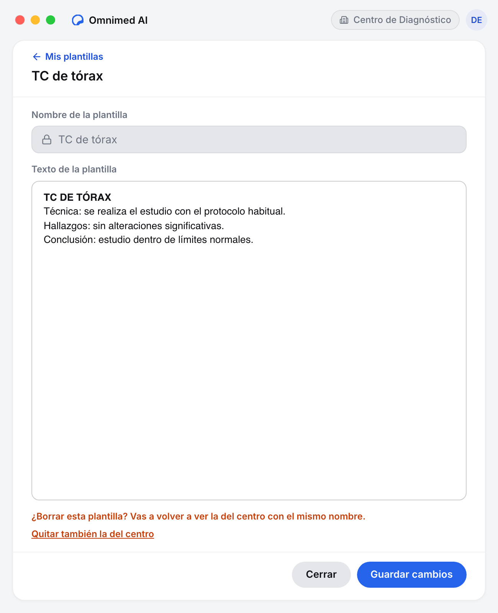
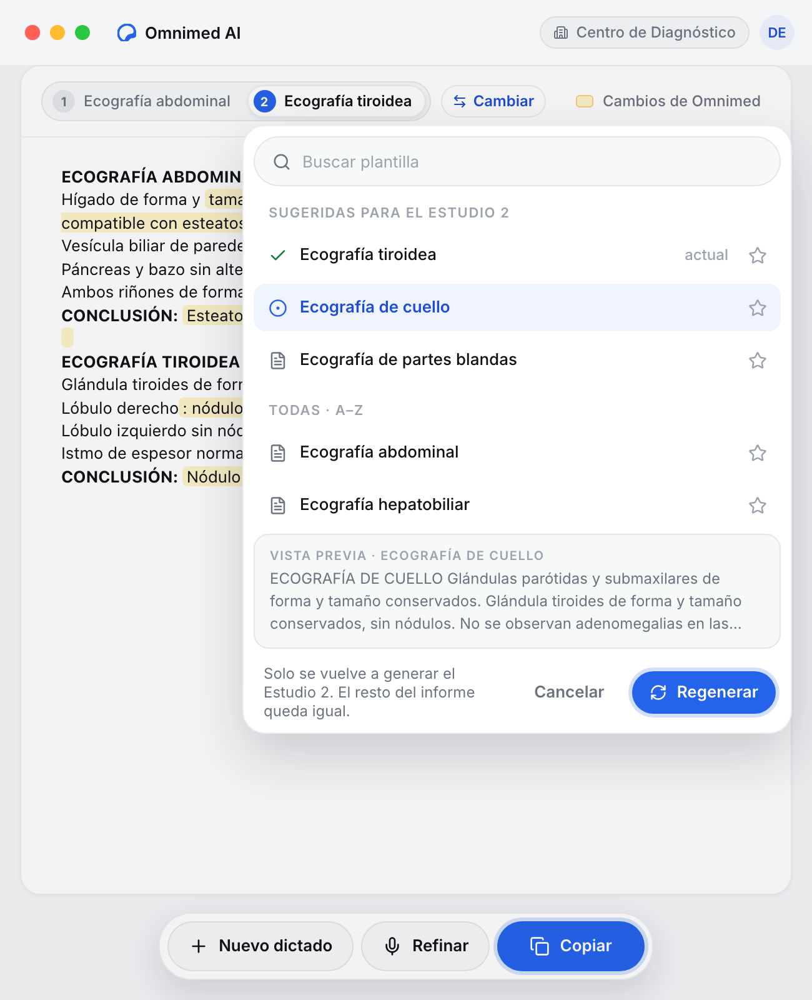
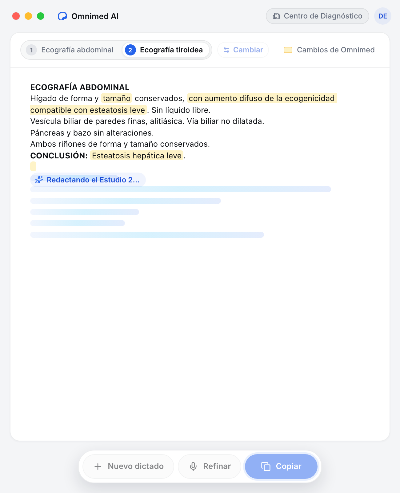

# Omnimed v3.5.0 · Tu lista de plantillas, a tu medida

Tres cosas que nos pidieron: sacar de tu lista las plantillas que no usás, borrar las que creaste vos, y cambiar la plantilla de un solo estudio cuando dictaste varios juntos.

## Qué vas a ver

### Quitar de tu lista las plantillas que no usás
El centro carga las plantillas de todos los especialistas, pero cada uno usa unas pocas. Ahora podés sacar de **tu** lista las que no usás: abrí **Mis plantillas**, tocá **Editar** en la plantilla y después **Quitar de mis plantillas**. Te pide confirmar con un segundo clic.

- Deja de aparecer en tu lista y en el selector, y Omnimed **ya no la elige cuando dictás**. Con menos plantillas parecidas compitiendo, acierta más seguido la que querés.
- **Solo cambia para vos.** Tus colegas la siguen viendo igual; no se borra nada del centro.
- Si era una de tus favoritas, pierde la estrella.

### Las que quitaste quedan en «Ocultas», por si las querés de vuelta
Al final de **Mis plantillas** hay una sección nueva, **Ocultas**. Tocá el título para desplegarla y **Volver a mostrar** en la que quieras recuperar.

### Borrar las plantillas que creaste vos
Las plantillas con la etiqueta **Creada por mí** ahora se pueden borrar: **Editar** y después **Borrar plantilla**, con un segundo clic para confirmar. Esas son solo tuyas, así que al borrarlas no le cambia nada a nadie.

Si tu plantilla tenía el mismo nombre que una del centro, al borrarla vas a volver a ver la del centro. Si tampoco querés esa, tocá **Quitar también la del centro** en ese mismo paso.

### Cambiar la plantilla de un solo estudio cuando dictaste varios
Cuando dictás varios estudios juntos, el informe muestra un botón por cada estudio. Si Omnimed eligió mal la plantilla de uno, ya no hace falta dictar de nuevo: tocá el estudio, después **Cambiar**, elegí la plantilla correcta y **Regenerar**.

Solo se vuelve a escribir ese estudio, con lo mismo que dictaste para él. Los demás quedan como estaban, con lo que les hayas corregido a mano.

- Si ya habías corregido algo en el estudio que vas a cambiar, Omnimed te avisa antes, porque esas correcciones se pierden.
- Podés repetirlo con otro estudio del mismo informe.
- Si le cambiaste la primera línea a un estudio, Omnimed no puede ubicarlo para reemplazarlo y te lo dice: en ese caso hay que dictarlo de nuevo.

### Un arreglo al elegir la plantilla
Si dictabas «Tomografía de tórax, abdomen y pelvis» y tenías la de tórax entre tus favoritas, a veces Omnimed tomaba la de tórax sola. Ahora lee el nombre completo del estudio antes de elegir.

## Qué no cambia
- Dictar, generar, refinar y copiar el informe funcionan igual que en la 3.4.0.
- Lo que copiás al sistema del centro es el mismo texto de siempre (más tu firma, solo si la activás).
- Tus favoritas, tus versiones de las plantillas del centro y las plantillas que te asignó el centro siguen como estaban. Nada se oculta ni se borra solo.
- La burbuja, el modo oscuro, los atajos de teclado, la firma y los Autotextos siguen igual.

## Cómo actualizar
La aplicación se actualiza sola al reiniciarla; cuando la versión nueva ya está descargada, en el menú de tu cuenta aparece **Reiniciar y actualizar**. Si preferís hacerlo a mano, descargá el instalador desde esta página: en Windows `Omni.AI.Setup.3.5.0.exe`, en Mac `Omnimed-AI-3.5.0-universal.dmg` (abrilo y **arrastrá Omnimed AI a la carpeta Aplicaciones**; si te pregunta, elegí Reemplazar).
