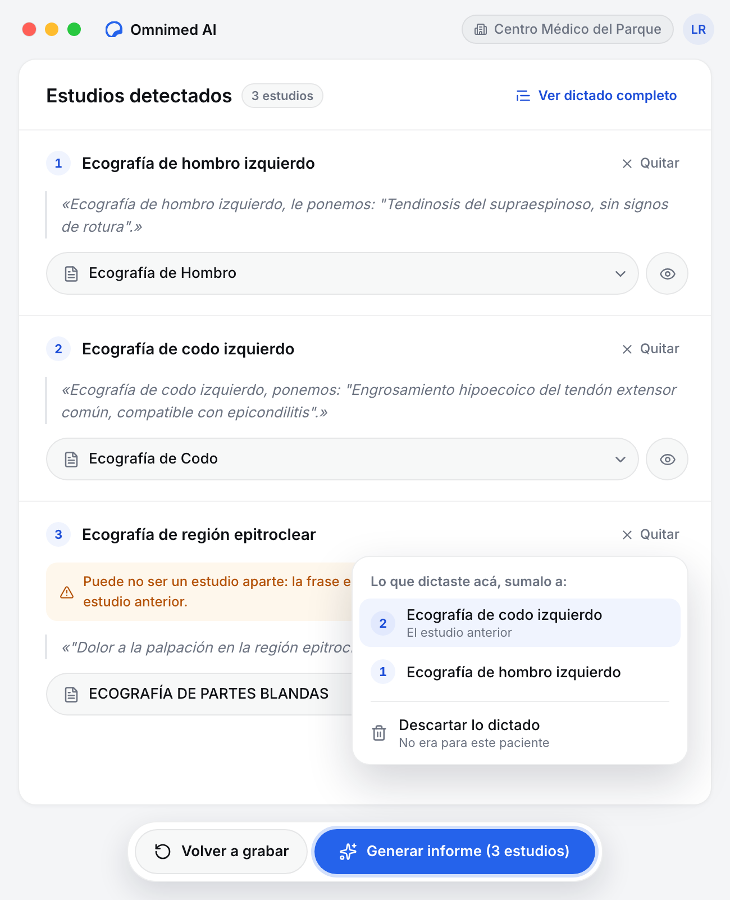
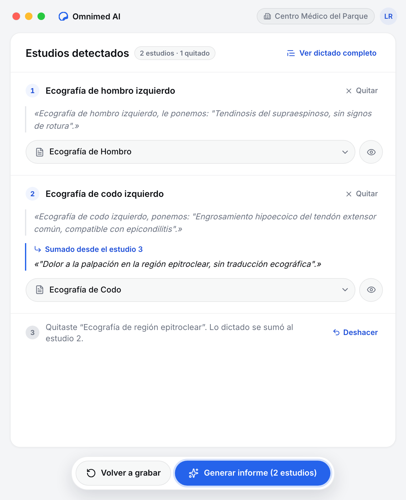
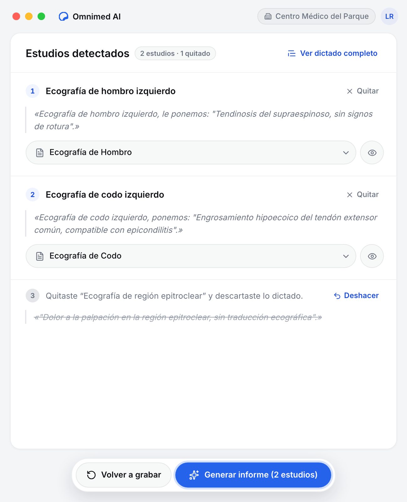
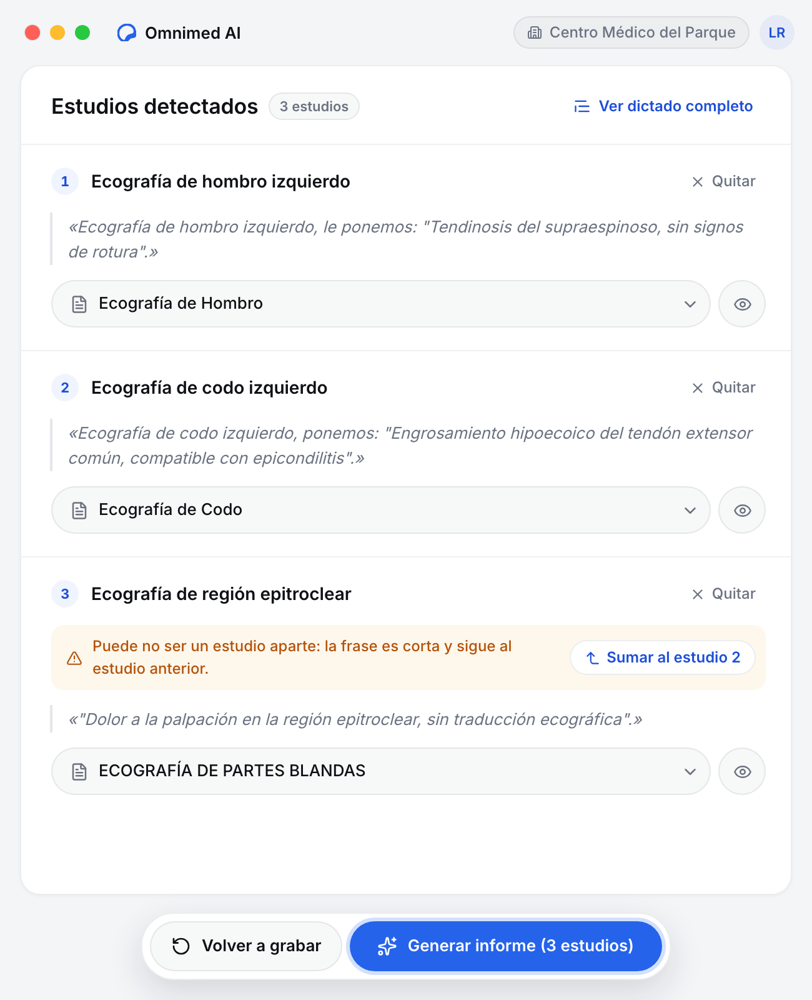
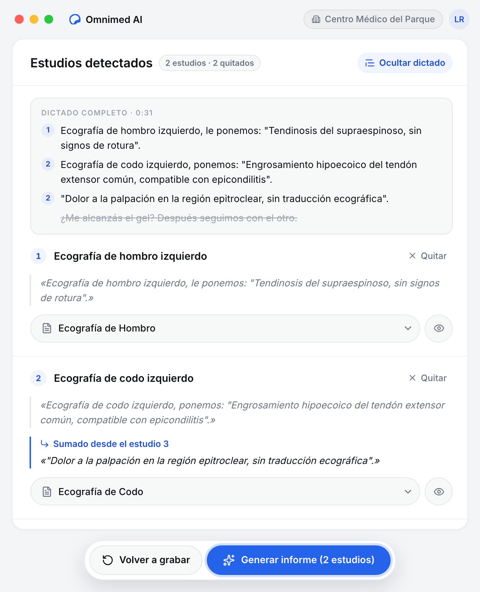

# Omnimed v3.6.0 · Lo que dictás no se pierde al quitar un estudio

Cuando dictás varios estudios juntos, a veces Omnimed separa una frase como si fuera un estudio aparte. Hasta ahora, al quitar ese estudio, la frase desaparecía y nunca llegaba al informe. Desde esta versión elegís a dónde va.

## Qué vas a ver

### Quitar te pregunta a dónde va lo dictado
En **Estudios detectados**, al tocar **Quitar** en un estudio donde dictaste algo, aparece un menú: **«Lo que dictaste acá, sumalo a:»**. Arriba está el estudio anterior, ya marcado: con **Enter** lo sumás ahí. También podés elegir otro estudio o **Descartar lo dictado** si no era para este paciente (por ejemplo, si el micrófono tomó a alguien que hablaba al lado).

### La frase pasa al estudio que elegiste
La frase aparece debajo del estudio elegido, marcada **«Sumado desde el estudio 3»**, y entra en ese informe. Donde estaba el estudio quitado queda una línea que dice a dónde fue, con **Deshacer** por si te equivocaste.

Si la descartás, la ves tachada, también con **Deshacer**.

### Un atajo en el aviso amarillo
Cuando Omnimed sospecha que una frase corta no es un estudio aparte, el aviso amarillo ahora trae el botón **Sumar al estudio N**: con un clic la frase pasa al estudio anterior, sin abrir el menú.

### «Ver dictado completo» muestra dónde quedó cada frase
Cada frase lleva el número del estudio donde va a entrar. Lo descartado aparece tachado y sin número.

### Detalles
- Si en el estudio solo dijiste su nombre, **Quitar** lo saca directo, como siempre: no hay nada que mover.
- Si quitás estudios hasta que queda uno solo, el informe sale con lo que sumaste y sin lo que descartaste.
- Además, Omnimed se equivoca menos al separar: una frase sobre una zona del mismo estudio (por ejemplo, «la región anteroexterna» después de un tobillo) ahora queda en ese estudio.

## Qué no cambia
- Dictar, generar, refinar y copiar el informe funcionan igual que en la 3.5.0.
- Cuando dictás un solo estudio, no cambia nada.
- Lo que copiás al sistema del centro es el mismo texto de siempre.
- Tus plantillas, favoritas, firma, Autotextos, la burbuja y los atajos siguen igual.

## Cómo actualizar
La aplicación se actualiza sola al reiniciarla. Cuando la versión nueva ya está descargada, en el menú de tu cuenta aparece **Reiniciar y actualizar**. Si preferís hacerlo a mano, descargá el instalador desde esta página:
- **Windows:** `Omni.AI.Setup.3.6.0.exe`.
- **Mac:** `Omnimed-AI-3.6.0-universal.dmg`. Abrilo y **arrastrá Omnimed AI a la carpeta Aplicaciones**; si te pregunta, elegí Reemplazar.
